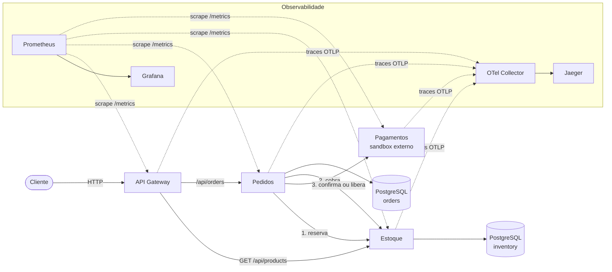

# Pedidos Veloz: do Docker Compose ao Kubernetes

Plataforma de pedidos da **Loja Veloz** em microsserviços, com ambiente local
reproduzível, imagens seguras e versionadas, deploy em Kubernetes, pipeline de
CI/CD, autoescala e observabilidade (métricas, logs e traces).

> 🎥 **Vídeo pitch:** https://youtu.be/zmzmqXmTCmA

---

## Arquitetura



| Serviço | Responsabilidade | Dados |
|---|---|---|
| **gateway** | Ponto de entrada único; roteia `/api/*`, aplica timeouts e limites | sem estado |
| **orders** | Cria e consulta pedidos; orquestra a **saga** reserva → pagamento → confirmação | banco `orders` |
| **inventory** | Catálogo, reserva e baixa de estoque com lock de linha (sem vender a mesma unidade duas vezes) | banco `inventory` |
| **payments** | Simula o provedor de pagamento externo (latência e taxa de recusa configuráveis) | sem estado |

**Fluxo de um pedido (saga orquestrada com compensação):**

1. `orders` grava o pedido como `PENDING`
2. reserva o estoque: sem estoque, o pedido fica **`REJECTED`** (HTTP 409)
3. cobra o pagamento: recusado, **libera a reserva** e o pedido fica **`PAYMENT_DECLINED`** (402)
4. confirma a reserva (baixa definitiva) e o pedido fica **`CONFIRMED`** (201)
5. dependência fora do ar: o pedido fica **`FAILED`**, a reserva é desfeita, e a resposta é 503

Todas as chamadas entre serviços são **idempotentes por `orderId`**, então o retry com backoff é seguro.

> **Por que não usar mensageria (RabbitMQ/Kafka) no MVP?** O cliente precisa da
> resposta do pedido na hora (aprovado ou recusado), e a saga síncrona com
> compensação resolve isso com menos peças para operar em 4 semanas. A evolução
> natural é publicar um evento `PedidoCriado` (padrão *outbox*) para
> consumidores que não estão no caminho crítico, como e-mail, nota fiscal e analytics.

---

## Estrutura do repositório

```
services/            4 microsserviços Node.js 24 (Express 5), cada um com Dockerfile e testes
  <serviço>/src/lib/   cópias geradas de /shared (não edite aqui)
shared/              observabilidade, ciclo de vida, cliente HTTP (fonte única)
db/init/             cria um banco e um usuário por serviço (database-per-service)
docker-compose.yml   ambiente local completo
observability/       config do OTel Collector, Prometheus (+ alertas) e Grafana (+ dashboard)
k8s/
  base/              Deployments, Services, HPA, PDB, ConfigMap, NetworkPolicies, Namespace (PSA)
  overlays/local/    kind/minikube: Postgres no cluster, secrets de dev, 1 réplica mínima
  overlays/production/ imagens do GHCR, RDS com TLS, HTTPRoute (Gateway API)
  observability/     OTel Collector + Jaeger + ServiceMonitor
  addons/            VPA em modo recomendação
infra/terraform/     VPC + EKS + RDS na AWS (esqueleto)
.github/workflows/   pipeline CI/CD
scripts/             smoke test, teste de carga (k6), dev sem Docker, sync de libs
```

---

## 1. Ambiente local (Docker Compose)

**Pré-requisito:** Docker Desktop (ou Docker Engine + Compose v2).

```bash
docker compose up --build
```

Pronto: um comando sobe os 4 serviços, o Postgres e a stack de observabilidade.

| O quê | URL |
|---|---|
| API (gateway) | http://localhost:8080 |
| Jaeger (traces) | http://localhost:16686 |
| Prometheus (métricas e alertas) | http://localhost:9090 |
| Grafana (dashboard "Pedidos Veloz") | http://localhost:3000 |

Testar ponta a ponta (precisa de Node 20+ na máquina):

```bash
node scripts/smoke-test.mjs
```

Ou à mão:

```bash
# catálogo
curl http://localhost:8080/api/products

# criar pedido
curl -X POST http://localhost:8080/api/orders \
  -H "Content-Type: application/json" \
  -d '{"customerId":"cliente-1","items":[{"sku":"NOTE-001","quantity":1}],"paymentMethod":"pix"}'

# consultar
curl http://localhost:8080/api/orders/<id>
```

No PowerShell:

```powershell
Invoke-RestMethod http://localhost:8080/api/orders -Method Post -ContentType 'application/json' -Body '{"customerId":"cliente-1","items":[{"sku":"NOTE-001","quantity":1}]}'
```

**Configuração:** tudo por variável de ambiente (12-Factor). Os defaults de
desenvolvimento já estão no Compose. Para mudar, copie `.env.example` para `.env`.
Exemplo: `PAYMENT_FAILURE_RATE=0.5` para ver compensações acontecendo.

**Segurança no Compose:** containers com sistema de arquivos só leitura,
`cap_drop: ALL`, `no-new-privileges` e usuário não-root. O banco fica numa rede
`internal` alcançável só por `orders` e `inventory`, e só o gateway publica porta.

### Sem Docker (só a lógica, em memória)

```bash
npm run install:all   # instala dependências de cada serviço
npm run dev           # sobe os 4 serviços com STORAGE=memory
npm test              # testes de todos os serviços
npm ci && npm run lint
```

---

## 2. Contêineres e versionamento

Cada `services/<serviço>/Dockerfile` usa **multi-stage**:

| Estágio | Função |
|---|---|
| `deps` | `npm ci --omit=dev` com lockfile: build reprodutível, só dependências de produção |
| `test` | roda os testes dentro da imagem (`docker build --target test`) |
| `runtime` | imagem final: `node:24-alpine`, **sem npm/yarn**, código de propriedade do root, **`USER 1000`**, `HEALTHCHECK`, labels OCI |

**Versionamento das imagens** (`ghcr.io/<owner>/pedidos-veloz-<serviço>`):

- `sha-<commit>`: toda build da `main`; imutável, rastreável até o commit
- `X.Y.Z` e `X.Y`: releases (tag git `vX.Y.Z`); é o que vai para produção
- SBOM e *provenance* anexados à imagem; scan com **Trivy** bloqueia CVE crítica com correção disponível

---

## 3. Kubernetes

### Rodando localmente com kind

```bash
kind create cluster --name pedidos-veloz

# metrics-server (fonte de CPU para o HPA)
kubectl apply -f https://github.com/kubernetes-sigs/metrics-server/releases/latest/download/components.yaml
kubectl -n kube-system patch deploy metrics-server --type=json \
  -p '[{"op":"add","path":"/spec/template/spec/containers/0/args/-","value":"--kubelet-insecure-tls"}]'

# imagens locais -> cluster
docker compose build
for s in gateway orders inventory payments; do kind load docker-image pedidos-veloz/$s:dev --name pedidos-veloz; done

kubectl apply -k k8s/observability
kubectl apply -k k8s/overlays/local
kubectl -n pedidos-veloz get pods -w

kubectl -n pedidos-veloz port-forward svc/gateway 8080:80
node scripts/smoke-test.mjs
```

### Práticas de produção aplicadas

| Prática | Onde |
|---|---|
| Deployments + Services, labels padrão `app.kubernetes.io/*` | `k8s/base/*.yaml` |
| **ConfigMap** (config) separado de **Secret** (senhas) | `k8s/base/configmap.yaml`, `secretGenerator` (local) / pipeline (prod) |
| **startup / readiness / liveness probes**: liveness não depende do banco, readiness sim | todos os Deployments |
| Desligamento gracioso: readiness 503, espera, drena conexões | `shared/lifecycle.js` + `SHUTDOWN_DELAY_MS` |
| **Pod Security Admission `restricted`** no namespace | `k8s/base/namespace.yaml` |
| `runAsNonRoot`, `readOnlyRootFilesystem`, `drop: [ALL]`, seccomp, sem token da API | `securityContext` dos pods |
| **NetworkPolicies** deny-by-default + fluxos liberados explicitamente | `k8s/base/network-policies.yaml` |
| requests/limits de CPU e memória | todos os containers |
| PodDisruptionBudget + topologySpread entre nós | `k8s/base/*.yaml` |
| Ambientes com **Kustomize** (base + overlays) | `k8s/overlays/*` |

### Estratégia de deploy: Rolling Update

`maxSurge: 1, maxUnavailable: 0` + readinessProbe + `minReadySeconds`: um pod
novo sobe, fica saudável e só então um antigo sai. A capacidade nunca cai
durante o deploy. Se o rollout não concluir em 180s, o pipeline executa
`kubectl rollout undo`.

**Por que rolling e não blue/green ou canary no MVP?** É nativo do Kubernetes (zero
ferramenta extra) e, com probes corretas e compatibilidade de schema entre
versões, já elimina a indisponibilidade em deploy, o problema nº 1 da Loja Veloz.
Blue/green dobra o custo durante o deploy. **Canary** (Argo Rollouts ou Istio,
liberando 10% → 50% → 100% do tráfego com análise automática das métricas de
erro do Prometheus) é o próximo passo, quando houver volume para a análise ser
estatisticamente útil.

### Escalabilidade: HPA (+ VPA só como recomendação)

- **HPA** em todos os serviços pela CPU (alvo 70%): mínimo 2 réplicas (alta disponibilidade), até 10 (20 em produção para gateway e orders)
- sobe rápido (pode dobrar a cada 30s) e desce devagar (janela de 5 min, 1 pod/min), sem oscilar
- **VPA em modo `Off`** (`k8s/addons/`): só *recomenda* requests. HPA e VPA atuando sobre a mesma métrica (CPU) entram em conflito, então o HPA decide *quantas* réplicas e o VPA ajuda a calibrar *o tamanho* de cada uma
- Teste de pico: `k6 run scripts/load-test.js` + `kubectl -n pedidos-veloz get hpa -w`

---

## 4. CI/CD (GitHub Actions)

Arquivo: [.github/workflows/ci-cd.yml](.github/workflows/ci-cd.yml)

```
PR / push ──► lint ──────────┐
              (ESLint, hadolint, kubeconform, compose config, terraform validate)
          ──► testes (matriz 4 serviços) ──► integração (compose up + smoke test)
                                                   │
                                                   ▼
                                    build ► scan Trivy ► push GHCR (SBOM + provenance)
                                                   │  (só em tag vX.Y.Z)
                                                   ▼
                          deploy production (aprovação manual) ► rollout status ► rollback se falhar ► smoke test
```

**Secrets:** o `GITHUB_TOKEN` publica no GHCR (permissão `packages: write` só
no job de build). Os segredos de produção ficam no GitHub **Environment
`production`** (com *required reviewers*) e só o job de deploy os enxerga:

| Nome | Tipo | Conteúdo |
|---|---|---|
| `KUBE_CONFIG` | secret | kubeconfig do cluster, em base64 |
| `ORDERS_DB_PASSWORD` / `INVENTORY_DB_PASSWORD` | secret | senhas dos usuários dos serviços no RDS |
| `DB_HOST` | variable | saída `db_endpoint` do Terraform |

Sem `KUBE_CONFIG`, o pipeline publica as imagens e pula o deploy com um aviso.

Para lançar uma versão:

```bash
git tag v0.1.0 && git push origin v0.1.0
```

---

## 5. Observabilidade

| Sinal | Como | Onde ver |
|---|---|---|
| **Métricas** | `prom-client`: latência por rota (histograma), taxa de erro, `orders_total{status}`, duração da saga, pagamentos e reservas por resultado, métricas do runtime | Prometheus `:9090`, Grafana `:3000` |
| **Logs** | JSON estruturado em stdout (pino), com `service`, `version` e **`trace_id`** | `docker compose logs -f orders` / `kubectl logs` (coletor: Loki/CloudWatch) |
| **Traces** | **OpenTelemetry** com instrumentação automática de HTTP, Express, `fetch` e `pg`. O contexto (`traceparent`) é propagado entre os serviços, e o Collector exporta para o Jaeger | Jaeger `:16686` |
| **Alertas** | golden signals: serviço fora, erro 5xx > 5%, p95 > 1s, pedidos FAILED > 2% | `observability/alerts.yml` |

**Investigar uma falha:** alerta de erro no Grafana → no Jaeger, filtre `orders`
com `error=true` → o trace mostra qual chamada (estoque? pagamento? banco?)
falhou e quanto tempo levou → copie o `trace_id` e busque os logs com ele.

**Service mesh:** não usado no MVP. A propagação de contexto e as métricas já
vêm do OpenTelemetry no código, e NetworkPolicy cobre o isolamento de rede. Istio
(modo *ambient*) entraria para **mTLS automático** entre serviços e para o
**canary** por peso de tráfego, quando o ganho justificar o custo operacional.

---

## 6. Infraestrutura como código (Terraform)

`infra/terraform/`: **esqueleto** da produção na AWS (`sa-east-1`):

- **VPC** com 3 AZs e subnets públicas (LB), privadas (nós) e de banco (isoladas)
- **EKS** com node group gerenciado, add-ons `vpc-cni` (com NetworkPolicy) e `metrics-server`
- **RDS PostgreSQL 17** Multi-AZ, criptografado, com backup de 7 dias e senha gerenciada no Secrets Manager
- **state remoto** em S3 com lock, e um `tfvars` por ambiente (staging/production)

```bash
cd infra/terraform
terraform init -backend-config=environments/production.backend.hcl
terraform plan  -var-file=environments/production.tfvars
```

---

## Mapa: requisitos do trabalho → onde estão

| Requisito | Arquivo(s) |
|---|---|
| Compose multi-serviço, um comando, redes/volumes/env | `docker-compose.yml`, `.env.example` |
| Dockerfiles multi-stage, não-root, enxutos | `services/*/Dockerfile` |
| Versionamento de imagens | `ci-cd.yml` (job `build`), seção 2 |
| Deployments, Services, ConfigMaps, Secrets, probes | `k8s/base/`, `k8s/overlays/` |
| Segurança (PSA e equivalentes) | `namespace.yaml`, `securityContext`, `network-policies.yaml` |
| Pipeline: build, testes, publicação, secrets, lint, scan | `.github/workflows/ci-cd.yml` |
| Métricas, logs, traces | `shared/observability.js`, `shared/telemetry.js`, `observability/` |
| Estratégia de deploy | Rolling Update (seção 3) |
| HPA/VPA | `k8s/base/*.yaml` (HPA), `k8s/addons/vpa-recommendations.yaml` |
| IaC | `infra/terraform/` |

## Referências

- Kubernetes: [Deployments](https://kubernetes.io/docs/concepts/workloads/controllers/deployment/), [HPA](https://kubernetes.io/docs/tasks/run-application/horizontal-pod-autoscale/), [Pod Security Standards](https://kubernetes.io/docs/concepts/security/pod-security-standards/), [Probes](https://kubernetes.io/docs/concepts/configuration/liveness-readiness-startup-probes/)
- Docker: [Multi-stage builds](https://docs.docker.com/build/building/multi-stage/), [Compose](https://docs.docker.com/compose/)
- [The Twelve-Factor App](https://12factor.net/)
- [OpenTelemetry para Node.js](https://opentelemetry.io/docs/languages/js/)
- [Terraform: módulos AWS EKS/VPC](https://registry.terraform.io/namespaces/terraform-aws-modules)
- Case de referência: [Google Cloud "Online Boutique"](https://github.com/GoogleCloudPlatform/microservices-demo), e-commerce com 11 serviços gRPC, variações por componentes Kustomize (NetworkPolicies, bancos gerenciados, Istio, tracing) e gerador de carga Locust
